# EHR Blockchain Workspace

This repository contains a local academic/demo EHR workspace built around a Hyperledger Fabric network, Express APIs, React/Vite portals, an IPFS service, a lab gateway, and an optional read-only observability dashboard. It is a working project with unfinished integrations; it is not a production deployment or a legal/compliance certification.

FHIR R4, ABDM/ABHA, India DPDP Act 2023, HIPAA-style controls, and GDPR are design targets/reference points. Dashboard events are intended to contain zero patient-identifiable or clinical content. Digilocker remains proposed only.

## First-time setup (From a fresh git clone)

When cloning this repository for the first time on a new laptop or VM:

### 1. Prerequisites
- **OS:** Linux (Ubuntu 22.04 or 24.04 recommended) or Windows with WSL2 (Ubuntu).
- **Packages:** Docker Engine & Docker Compose plugin (`docker compose version`), Node.js (v20+), npm, Python 3.10+, curl, jq.
- Ensure Docker can be run without root:
  ```bash
  sudo usermod -aG docker "$USER"
  # Log out and log back in, or run: newgrp docker
  ```

### 2. Initialize application dependencies
```bash
./setup.sh
```

### 3. Bootstrap Hyperledger Fabric Network (First run only)
Because cryptographic MSP keys and CA databases are excluded from Git for security, generate the initial certificates and channel ledger:
```bash
cd orgs/hospital/EHR_hospitalOrg-main/ehr-network
bash scripts/network-up.sh
bash scripts/deployChaincode.sh
cd ../../../..
```

### 4. Launch the Complete Workspace
```bash
./start.sh
```
All 20 services, portals, AI agents, and the realtime dashboard will launch at [http://localhost/](http://localhost/).

## Start and stop

From the repository root:

```bash
./start.sh
```

The script checks that Docker and existing Fabric identity/CA material are present, starts the existing Fabric CAs and peer/orderer Compose stack, and then starts the app services in the root Compose file. It does **not** enroll identities, reset the channel or ledgers, delete Docker volumes, or deploy chaincode. The optional dashboard API and portal are started only when `dashboard-api/.env` exists; configuration values belong in that local ignored file, never in Git or chat.

Stop without deleting persistent data:

```bash
./stop.sh
```

`setup.sh` checks prerequisites, pulls selected images, and installs a subset of Node dependencies. It does not initialize Fabric identity material. `start-sequential.sh` is a legacy host-process launcher; the supported all-in-one local flow is `./start.sh`.

## Entry points

| Service | URL | Notes |
|---|---|---|
| Workspace hub | [http://localhost/](http://localhost/) | Links to all available portals and checks real-time reachability. |
| Hospital staff portal | [http://localhost:5173/](http://localhost:5173/) | React/Vite dev server; API requests use the peer APIs through configured proxy targets. |
| Patient portal | [http://localhost/patient/](http://localhost/patient/) or port `5174` | Hospital patient self-service portal. |
| System dashboard | [http://localhost/dashboard/](http://localhost/dashboard/) or port `5176` | Group 1 Real-time observability dashboard (Obsidian Glass UI) with 12 live telemetry targets, block stream inspector, 5 clinical agent views, and threshold alerts. |
| Clinical AI Agent | [http://localhost/ai-agent/docs](http://localhost/ai-agent/docs) or port `8000` | Autonomous Clinical Intelligence, Vital Signs Trend Analysis, and Medical RAG Microservice (FastAPI Swagger `/docs` and ReDoc). |
| Pharmacy main portal | [http://localhost/pharmacy/](http://localhost/pharmacy/) or port `5175` | MedBlock pharmacy consortium view with inventory stock and IPFS verification. |
| Pharmacy sub-portals | `/pharmacy/manager/` (`:3001`), `/employee/` (`:3002`), `/inventory/` (`:3003`), `/patient/` (`:3004`), `/billing/` (`:3005`) | Five dedicated Vite apps for Pharmacy Manager, Pharmacist Dispensing, Stock Officer, Patient Self-Governance, and Outpatient Billing. |
| Lab console & Multi-Agent Gateway | [http://localhost/lab/](http://localhost/lab/) or port `3006` | Multi-Agent diagnostic orchestrator (`lab-agent.js`, `history-agent.js`, `orchestrator.js`), human-in-the-loop review, and 4-hour ledger integrity checker. |

The pharmacy patient app (`http://localhost:3004` or `/pharmacy/patient/`) is fully functional, featuring active patient switching (`PAT-001`, `PAT-014`, `PAT-021`, `testuser`), verifiable prescription ledgers, dispensing timelines, consent self-governance (grant/revoke access), and IPFS billing receipts.

The standalone Digilocker proposal has no runnable service in this workspace.

## Architecture (as currently wired)

```mermaid
flowchart TB
  subgraph ClientLayer ["Client & Ingress Layer"]
    Browser["User in Browser"] --> Hub["Nginx :80 API Gateway"]
    Browser --> HospitalUI["Hospital Portal :5173"]
    Hub --> PatientUI["Patient Portal /patient/ (:5174)"]
    Hub --> DashUI["System Dashboard /dashboard/ (:5176)<br/>Obsidian Glass UI & Block Inspector"]
    Hub --> LabUI["Lab Console /lab/ (:3006)"]
    Hub --> PharmUI["Pharmacy UIs /pharmacy/*<br/>Main :5175, Mgr :3001, Emp :3002,<br/>Inv :3003, Patient :3004, Bill :3005"]
    Hub --> AIAgentRoute["Clinical AI /ai-agent/ (:8000)"]
  end

  subgraph MicroservicesLayer ["Microservices & Multi-Agent Layer"]
    HospitalUI --> P0["peer0-api :4001"]
    HospitalUI --> P1["peer1-api :4002"]
    HospitalUI --> P2["peer2-api :4003"]
    PatientUI --> PatientAPI["patient-api :4005"]
    PharmUI --> PharmAPI["p-backend :3000"]
    AIAgentRoute --> AIAgentService["clinical-ai-agent :8000<br/>FastAPI Medical RAG & Trend Analyzer"]
    LabUI --> LabGateway["Lab node-gateway :3006"]

    subgraph LabAgenticSubsystem ["Lab Multi-Agent Subsystem"]
      LabGateway --> LabAgent["Lab Agent (lab-agent.js)<br/>Report Analysis & Extraction"]
      LabGateway --> HistoryAgent["History Agent (history-agent.js)<br/>Longitudinal Trend Synthesis"]
      LabGateway --> LabOrchestrator["Human-in-the-Loop Orchestrator<br/>orchestrator.js & Approval State"]
      LabGateway --> IntegrityRecheck["Ledger Integrity Rechecker<br/>4-Hour Raw-Byte SHA-256 vs Fabric"]
    end
  end

  subgraph BlockchainLayer ["Hyperledger Fabric Consortium (ehrchannel)"]
    P0 --> FabricHospital[("peer0.hospital :7051<br/>HospitalMSP Reception/Admin")]
    P1 --> FabricDoctor[("peer1.hospital :9051<br/>HospitalMSP Doctor")]
    P2 --> FabricNurse[("peer2.hospital :10051<br/>HospitalMSP Nurse/Pharma")]
    PatientAPI --> FabricHospital
    Ext["extorg-api :4004"] --> FabricExt[("peer0.provider :11051<br/>ProviderMSP Claims")]
    LabGateway --> FabricDiag[("peer0.diagnostic :8051<br/>DiagnosticsMSP Lab Gateway")]
    OrdererNode[("orderer.example.com :7050<br/>Raft CFT Consensus")]

    FabricHospital --- OrdererNode
    FabricDoctor --- OrdererNode
    FabricNurse --- OrdererNode
    FabricExt --- OrdererNode
    FabricDiag --- OrdererNode
  end

  subgraph StorageLayer ["Decentralized & Persistent Storage"]
    IPFSAPI["ipfs-service :4006"] --> KuboIPFS[("Kubo IPFS Node<br/>ipfs.ehr.local:5001 / :8090")]
    PharmAPI --> KuboIPFS
    PharmAPI <--> PharmStore[("Pharmacy Persistent Store<br/>store.js & JSON State")]
    LabGateway --> KuboIPFS
    IntegrityRecheck -.->|Verify Multihashes| KuboIPFS
    IntegrityRecheck -.->|Verify Digest Hashes| FabricDiag
  end

  subgraph ObservabilityLayer ["Group 1 Observatory (Zero-PHI Compliant)"]
    FabricHospital -.->|Block Commit Observer| DashAPI["dashboard-api :4010"]
    FabricDoctor -.->|Operations /healthz :9445| DashAPI
    FabricDiag -.->|Operations /healthz :9446| DashAPI
    FabricExt -.->|Operations /healthz :9447| DashAPI
    OrdererNode -.->|Operations /healthz :9443| DashAPI
    AIAgentService -.->|Health Endpoint /health| DashAPI
    LabGateway -.->|Agent Telemetry /health| DashAPI
    PharmAPI -.->|Health Probe /health| DashAPI

    DashAPI --> DashUI
    DashAPI -.->|Normalizer & NDJSON Store| DashStore[("Append-Only NDJSON<br/>Event Cache & Checkpoint")]
    DashStore --> LiveStream["WebSocket /ws & SSE /stream"]
    LiveStream --> DashUI
  end
```



The current Fabric topology is configured through the Fabric network files. The local default channel is `ehrchannel`; the organizations are `HospitalMSP`, `DiagnosticsMSP`, and `ProviderMSP`. Dashboard topology values live in `dashboard-api/config/topology.json` and actively monitor all 12 consortium components.

## Service map

| Component | Host port / route | Current role |
|---|---:|---|
| `h-peer0-api` | `4001`, `/api/hospital/peer0/` | Reception/admin API and hospital login endpoint. |
| `h-peer1-api` | `4002`, `/api/hospital/peer1/` | Doctor API. |
| `h-peer2-api` | `4003`, `/api/hospital/peer2/` | Nurse/pharmacist/medical-record API. |
| `h-extorg-api` | `4004`, `/api/hospital/extorg/` | Diagnostics/provider API. |
| `h-patient-api` | `4005`, `/api/hospital/patient/` | Patient API. |
| `h-ipfs-service` | `4006`, `/api/hospital/ipfs/` | IPFS bridge API. |
| `clinical-ai-agent` | `8000`, `/ai-agent/` | FastAPI Clinical Intelligence, Medical RAG, PubMed literature citation, vital trajectory alerts. |
| `h-dashboard-api` | `4010` (loopback host binding), `/api/dashboard/` | Event store, committed-block collector, 12/12 node telemetry, realtime streams, and role-filtered aggregation API. |
| `h-dashboard-portal` | `5176` (loopback host binding), `/dashboard/` | Role-aware Luxury Obsidian Glass dashboard UI with opposite-corner card glow and Block Inspector. |
| `p-backend` | `3000`, `/api/pharmacy/` | Pharmacy REST API with persistent store (`store.js`), automatic inventory deduction, and IPFS receipt pinning. |
| `l-node-gateway` | `3006` host, `/lab/`, `/api/lab/` | Lab Multi-Agent Orchestrator (`lab-agent.js`, `history-agent.js`, `orchestrator.js`), human review console, and 4-hour ledger integrity checker. |

Use `docker compose ps` to see container state and `docker compose logs --tail=100 <service>` to inspect one service.

## Dashboard status and safety

The dashboard API and portal are implemented as a core observability module. The API includes HS256 JWT verification, a config-based default-deny role map, zero-PHI envelope validation, an append-only NDJSON event cache, a committed-block collector, bounded health polling, `POST /internal/events`, stream tickets, WebSocket/SSE routes, and REST aggregation/trace endpoints.

All 12 consortium nodes and agents are actively monitored and reporting `OK`:
1. `peer0.hospital.example.com` (HospitalMSP Admin/Auth peer operations `/healthz`)
2. `peer1.hospital.example.com` (HospitalMSP Doctor peer operations `/healthz`)
3. `peer0.diagnostic.example.com` (DiagnosticsMSP Lab peer operations `/healthz`)
4. `peer0.provider.example.com` (ProviderMSP Insurance peer operations `/healthz`)
5. `orderer.example.com` (Raft CFT Orderer operations `/healthz`)
6. `clinical-agent` (`clinical-ai-agent:8000/health` FastAPI RAG engine)
7. `history-agent` (Longitudinal patient trajectory agent in `l-node-gateway:3006`)
8. `governance-agent` (Consent self-governance policy agent in `l-node-gateway:3006`)
9. `lab-gateway` (`l-node-gateway:3006/api/health`)
10. `pharmacy-backend` (`p-backend:3000/health`)
11. `ipfs-service` (`h-ipfs-service:4006/health`)
12. `patient-api` (`h-patient-api:4005/health`)

The event store is a local operational cache, strictly enforcing Zero-PHI: patient identifiers are redacted into keyed hashes (`patientIdHash`), and clinical notes/AI narrative are omitted from envelopes. Real-time ledger block streaming and ASN.1 SHA-256 header hashing verify that block $N$'s `previousHash` matches block $N-1$'s `blockHash` with an interactive 1-click clipboard Block Inspector Panel.

See [dashboard API README](file:///home/himanshu/Desktop/EHR_blockchain/orgs/hospital/EHR_hospitalOrg-main/ehr-backend-v3/dashboard-api/README.md), [dashboard portal README](file:///home/himanshu/Desktop/EHR_blockchain/orgs/hospital/EHR_hospitalOrg-main/ehr-frontend-v2/dashboard-portal/README.md), [dashboard handoff](file:///home/himanshu/Desktop/EHR_blockchain/docs/dashboard/PROJECT_HANDOFF.md), [dependencies](file:///home/himanshu/Desktop/EHR_blockchain/docs/dashboard/DEPENDENCIES.md), and [testing notes](file:///home/himanshu/Desktop/EHR_blockchain/docs/dashboard/TESTING.md).

## Pharmacy, Lab, and Clinical AI Boundaries

1. **Clinical AI Agent Subsystem:**
   - Containerized FastAPI microservice running on port `8000` (`clinical-ai-agent`), accessible via Nginx at `/ai-agent/`.
   - Evaluates vital signs against clinical guidelines (hypertensive crisis, hypoxia, hypoglycemia).
   - Medical RAG engine querying PubMed clinical literature with hybrid retrieval and confidence scoring.
   - Fully covered by 20 passing pytest test suites.

2. **Lab Multi-Agent Orchestrator:**
   - Integrated into `l-node-gateway:3006` and routed via Nginx at `/lab/` and `/api/lab/`.
   - Incorporates `lab-agent.js` (Lab Report Analysis Agent), `history-agent.js` (Longitudinal History Agent), and `orchestrator.js` (Human-in-the-Loop review state machine).
   - Connects to shared `ehrchannel` as `DiagnosticsMSP` and pins diagnostics payloads to the shared Kubo IPFS node.
   - Includes automated 4-hour background ledger-integrity rechecking that reads raw bytes from IPFS, computes SHA-256 hashes, and cross-checks them against on-chain Fabric digests.

3. **Pharmacy Organization:**
   - Integrated into the master Compose stack with 6 separate frontends (`:5175`, `:3001`–`:3005`).
   - `p-backend:3000` connects to a persistent file store (`store.js`), automatically deducts stock upon dispensing, and pins prescription bills to Kubo IPFS (`http://localhost:8090/ipfs/<CID>`).
   - CarePoint Patient Portal (`:3004`) allows live patient switching (`PAT-001`, `PAT-014`, `PAT-021`, `testuser`), prescription tracking, dispensing timelines, and patient consent self-governance (grant/revoke access).

## 👨‍💻 Project Contributions

> Detailed individual contribution walkthrough: [MY_CONTRIBUTION.md](MY_CONTRIBUTION.md)

- **Lead System Orchestration (Himanshu — `devbyhimans`)**:
  - Engineered master startup (`./start.sh`) and teardown (`./stop.sh`) with automated port-sweeping and named volume isolation.
  - Built unified Nginx API Gateway (`nginx/nginx.conf` on Port 80) routing all frontends, microservices, and WebSockets.
  - Resolved Raft Orderer TLS certificate genesis mismatch (`configtxgen` resync) and cross-platform native binary compilation crashes.
- **Group 1 Real-Time Event Architecture (Novelty Track)**:
  - Designed the Hyperledger Fabric block commit collector, atomic checkpointing (`checkpoint.json`), and Zero-PHI event normalizer.
  - Implemented high-performance WebSocket (`/ws`) and Server-Sent Events (`/stream`) real-time pipeline.
  - Developed 5 dedicated clinical agent views (`DoctorAgent.jsx`, `NurseAgent.jsx`, `PharmacyAgent.jsx`, `LabAgent.jsx`, `ClinicalAgentPage.jsx`) and the real-time threshold alert engine (`Alerts.jsx`).
  - Authored all 76 passing automated backend test suites.
- **Pharmacy Resiliency & Patient Portal Overhaul**:
  - Eliminated root-cause HTTP 500 errors across `/api/inventory` and billing routes via persistent storage (`store.js`) and Docker network bridging.
  - Built automatic inventory stock deduction and Kubo IPFS multihash receipt generation.
  - Completely engineered the CarePoint Pharmacy Patient Portal (`:3004`) from a static placeholder into a live, interactive healthcare application.
- **Database & Storage Architecture**:
  - Authored comprehensive [DATABASE_README.md](DATABASE_README.md) mapping Fabric State DB (GoLevelDB/CouchDB), Kubo IPFS, and local operational stores.
- **CareGrid Soft Glass Bento Frontend Redesign**:
  - Built unified semantic design tokens (`packages/caregrid-ui/src/tokens.css`) implementing the Soft Glass Bento visual language (frosted blur, pastel tints, ink-pill buttons, dark mode).
  - Created reusable blockchain trust components (`VerifiedBadge.jsx`, `HashChip.jsx`, `DataSourceTag.jsx`, `BentoCard.jsx`).
  - Redesigned Patient Portal (`:5174`) and Hospital Staff Portal (`:5173`) with rich bento layouts and curated free Unsplash clinical imagery.
  - Authored automated synchronization script (`scripts/sync-ui.sh`) and frontend contract registry (`docs/redesign/FRONTEND_CONTRACT.md`).
- **Consortium Multi-Agent & Resilience Lead**:
  - Containerized FastAPI Clinical AI Agent (`clinical-ai-agent:8000`) with offline PubMed RAG, vital signs trajectory alerts, and Nginx reverse proxy at `/ai-agent/`.
  - Resolved merge conflicts across 5 core files (`docker-compose.yaml`, `gateway.js`, `public/index.html`, `public/app.js`, `public/styles.css`), unifying Lab Multi-Agent Orchestration with the radiant gradient UI.
  - Fixed Lab Gateway startup crash (`createIntegrityChecker` missing reference in `server.js`).
  - Configured 12/12 live telemetry health targets in `topology.json`, achieving 100% healthy status on the Observatory Dashboard.
  - Verified 100% automated test pass rates across all 4 tech stacks (76 Node tests, 20 Python pytest tests, 24 Lab agent Jest tests, and end-to-end integration).

## Repository map

```text
services/
  ai-agent/                     FastAPI Clinical Intelligence & Medical RAG microservice
orgs/hospital/EHR_hospitalOrg-main/
  ehr-network/                  Fabric network scripts/configuration (Hospital, Diagnostics, Provider)
  ehr-backend-v3/               Hospital APIs, IPFS bridge service, and dashboard-api
  ehr-frontend-v2/              Hospital (:5173), patient (:5174), and dashboard-portal (:5176)
  ehr-chaincode-v3/              Eight Fabric smart contracts
orgs/pharmacy/fabric-network-swarm/
  app/backend/                  Pharmacy API (app.js & persistent store.js)
  app/{manager,employee,inventory,billing,frontend}/ Dedicated pharmacy UIs
  app/patient/                  CarePoint interactive patient portal (Vite/React :3004)
orgs/lab/EHR-LABORG-main/        Lab gateway/UI, Multi-Agent Orchestrator, and integrity checker
docs/                           Architecture, setup, dashboard, audit, and changelogs
nginx/hub/                      Single-entry API gateway and service hub (:80)
```

## Documentation
- [Author Contribution Guide](file:///home/himanshu/Desktop/EHR_blockchain/MY_CONTRIBUTION.md)
- [Comprehensive Project Changelog](file:///home/himanshu/Desktop/EHR_blockchain/CHANGELOG.md)
- [Implementation Changelog & Timeline](file:///home/himanshu/Desktop/EHR_blockchain/docs/IMPLEMENTATION_CHANGELOG.md)
- [Vitalis Redesign & Gateway Implementation Report](file:///home/himanshu/Desktop/EHR_blockchain/REDESIGN_REPORT.md)
- [Database & Storage Architecture](file:///home/himanshu/Desktop/EHR_blockchain/DATABASE_README.md)
- [Current architecture diagrams](file:///home/himanshu/Desktop/EHR_blockchain/docs/architecture.md)
- [System overview](file:///home/himanshu/Desktop/EHR_blockchain/docs/system-overview.md)
- [Setup guide](file:///home/himanshu/Desktop/EHR_blockchain/docs/setup-guide.md)
- [Clinical AI Agent Documentation](file:///home/himanshu/Desktop/EHR_blockchain/services/ai-agent/README.md)
- [Lab Multi-Agent & Gateway Documentation](file:///home/himanshu/Desktop/EHR_blockchain/orgs/lab/EHR-LABORG-main/README.md)
- [Pharmacy Architecture & API Guide](file:///home/himanshu/Desktop/EHR_blockchain/orgs/pharmacy/fabric-network-swarm/README.md)
- [Dashboard API Documentation](file:///home/himanshu/Desktop/EHR_blockchain/orgs/hospital/EHR_hospitalOrg-main/ehr-backend-v3/dashboard-api/README.md)
- [Dashboard Portal Documentation](file:///home/himanshu/Desktop/EHR_blockchain/orgs/hospital/EHR_hospitalOrg-main/ehr-frontend-v2/dashboard-portal/README.md)
- [Hospital Multi-System Guide](file:///home/himanshu/Desktop/EHR_blockchain/orgs/hospital/EHR_hospitalOrg-main/README.md)
- [Hospital EHR Chaincode Guide](file:///home/himanshu/Desktop/EHR_blockchain/orgs/hospital/EHR_hospitalOrg-main/ehr-chaincode-v3/README.md)
- [IPFS Bridge Service Guide](file:///home/himanshu/Desktop/EHR_blockchain/orgs/hospital/EHR_hospitalOrg-main/ehr-backend-v3/ipfs-service/README.md)

## Safety and data

Use synthetic test accounts and data locally. Do not commit `.env` files, wallets, TLS private keys, patient data, or dashboard event-store data. The portal theme (light/dark) is shared across local interfaces using the `ehr_appearance` preference; theme state is presentation-only and grants no access.
