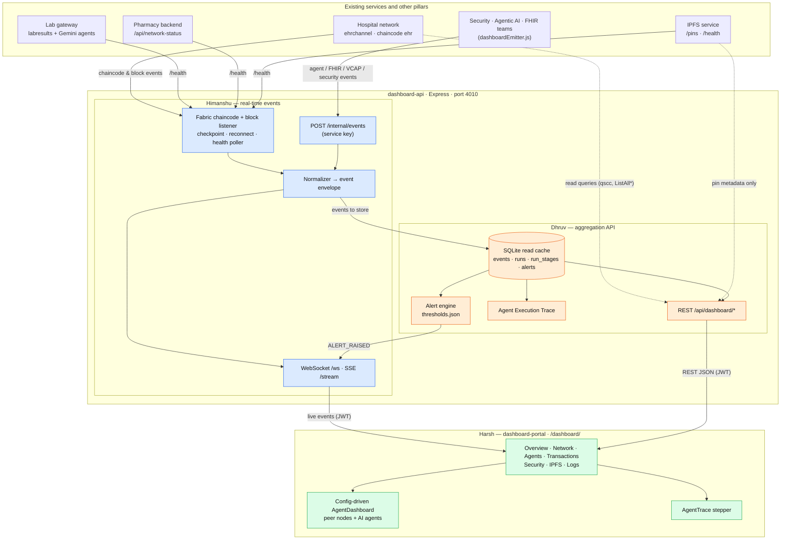
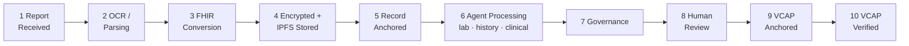

# EHR Blockchain Workspace

This repository contains a production-grade academic/demo Electronic Health Record (EHR) Consortium platform built around a Hyperledger Fabric 2.5 blockchain network (`ehrchannel`), containerized Express microservices, off-chain Kubo IPFS storage, an autonomous clinical AI agent, a multi-agent laboratory diagnostics gateway with VCAP provenance, an authentic DigiLocker clinical vault, an HL7 FHIR R4 interoperability layer, and a real-time observability dashboard.

FHIR R4, ABDM/ABHA, India DPDP Act 2023, HIPAA-style controls, and GDPR are design targets and reference implementations. All public dashboard events and ledger writes follow a strict Zero-PHI architecture (keyed HMAC hashes, CIDs, and cryptographic digests only).

## First-time setup (From a fresh git clone)

When cloning this repository for the first time on a new laptop or VM:

### 1. Prerequisites
- **OS:** Linux (Ubuntu 22.04 or 24.04 recommended) or Windows with WSL2 (Ubuntu).
- **Packages:** Docker Engine & Docker Compose plugin (`docker compose version`), Node.js (v20+), npm, Python 3.10+, curl, jq.
- Ensure Docker can be run without root:
  ```bash
  sudo usermod -aG docker "$USER"
  # Log out and log back in, or run: newgrp docker
  ```

## 🧬 Complete System Architecture

The network connects **5 Fabric Peers** across 3 autonomous organizations (`HospitalMSP`, `DiagnosticsMSP`, `ProviderMSP`), orchestrated by a Raft consensus Orderer, 4 Certificate Authorities, 10 Microservice Gateways, and 6 active Web Portals:

```mermaid
flowchart TB
    subgraph Clients["1. Client Frontends Tier"]
        HUB["🌐 Consortium Showcase Hub<br/>(Port :80 - NGINX Gateway)<br/>Split Showcase Cards & Telemetry"]
        HP["🏥 Hospital Web Portal<br/>(Port :5173 - React/Vite)<br/>Staff: Reception, Doctor, Nurse, Admin"]
        PP["👤 Patient Web Portal<br/>(Port :5174 - React/Vite)<br/>Self-Service: Consent, Timeline, DigiLocker Vault"]
        PHARM_FE["💊 Unified Pharmacy Suite<br/>(Port :5175 - React/Vite)<br/>Zero-Trust RBAC: Manager, Pharmacist, Inventory, Billing, Patient"]
        LAB_FE["🧪 Lab Control Deck<br/>(Port :3006 - HTML5/JS)<br/>Lab Reports & AI Diagnostics"]
        DASH_FE["📊 Real-Time Observatory Dashboard<br/>(Port :5176 - React/Vite)<br/>12 Live Telemetry Targets & WebSocket Stream"]
    end

    subgraph Gateways["2. Microservice & REST Gateway Tier"]
        P0_API["peer0-api (:4001)<br/>Receptionist & Admin Gateway"]
        P1_API["peer1-api (:4002)<br/>Doctor & MedRecords Gateway"]
        P2_API["peer2-api (:4003)<br/>Nurse & Pharmacist Gateway"]
        EXT_API["extorg-api (:4004)<br/>Diagnostics & Provider Gateway"]
        PAT_API["patient-api (:4005)<br/>Patient Vault & Consent Gateway"]
        IPFS_SVC["ipfs-service (:4006)<br/>Off-chain Storage Bridge"]
        DL_SVC["digilocker-service (:4007)<br/>Clinical PDF Generator & Vault"]
        DASH_API["dashboard-api (:4010)<br/>Event Normalizer & Realtime Stream"]
        AI_AGENT["clinical-ai-agent (:8000)<br/>Clinical Decision Support & RAG"]
        L_NODE["l-node-gateway (:3006)<br/>Multi-Agent Orchestrator & VCAP"]
        P_BACK["p-backend (:3000)<br/>Pharmacy Core Engine"]
    end

    subgraph InteropPillar["3. Interoperability & Provenance Layer"]
        FHIR_CORE["HL7 FHIR R4 Engine<br/>(/fhir - Adapters, Hasher, Validator)"]
        TOOL_VCAP["Sushil Tool Layer & VCAP<br/>(Fabric/IPFS/Hospital/Pharmacy Tools)"]
    end

    subgraph FabricNetwork["4. Hyperledger Fabric Network Tier (channel: ehrchannel, chaincode: ehr_3.1)"]
        subgraph HospMSP["Hospital Organization (HospitalMSP)"]
            PEER0["📋 Reception & Admin Peer<br/>(peer0.hospital.example.com:7051)"]
            PEER1["🏥 Doctor Peer<br/>(peer1.hospital.example.com:9051)"]
            PEER2["🩺 Nurse & Pharmacy Peer<br/>(peer2.hospital.example.com:10051)"]
        end

        subgraph DiagMSP["Diagnostics Organization (DiagnosticsMSP)"]
            PEER_DIAG["🧪 Lab & Diagnostics Peer<br/>(peer0.diagnostic.example.com:8051)"]
        end

        subgraph ProvMSP["Provider Organization (ProviderMSP)"]
            PEER_PROV["💳 Insurance & Billing Peer<br/>(peer0.provider.example.com:11051)"]
        end

        subgraph OrdererGroup["Consensus Cluster (OrdererMSP)"]
            ORDERER["orderer.example.com<br/>Port: 7050 | Admin: 7053<br/>Raft Consensus Leader"]
        end

        subgraph CAGroup["Fabric Certificate Authorities"]
            CA_HOSP["ca-hospital (:7055)"]
            CA_DIAG["ca-diagnostics (:7056)"]
            CA_PROV["ca-provider (:7057)"]
            CA_ORD["ca-orderer (:7054)"]
        end
    end

    subgraph StorageLayer["5. Decentralized Off-Chain Storage Tier"]
        IPFS_NODE["IPFS Kubo Node<br/>(ipfs.ehr.local :5001 / :8090)<br/>Encrypted Payloads & Clinical PDFs"]
    end

    %% Client Routing
    HUB --> HP
    HUB --> PP
    HUB --> PHARM_FE
    HUB --> LAB_FE
    HUB --> DASH_FE
    HP --> P0_API & P1_API & P2_API
    PP --> PAT_API & DL_SVC
    PHARM_FE --> P_BACK & P2_API
    LAB_FE --> L_NODE & EXT_API
    DASH_FE --> DASH_API

    %% Gateway to Interop & Storage
    P0_API & P1_API & EXT_API -.-> FHIR_CORE
    L_NODE -.-> TOOL_VCAP
    P1_API & EXT_API & DL_SVC & P_BACK --> IPFS_SVC
    IPFS_SVC --> IPFS_NODE

    %% Gateway to Fabric Peers
    P0_API --> PEER0
    P1_API --> PEER1
    P2_API --> PEER2
    EXT_API --> PEER_DIAG & PEER_PROV
    PAT_API --> PEER0 & PEER1
    DL_SVC --> PEER0
    L_NODE --> PEER_DIAG

    %% Blockchain Consensus
    PEER0 & PEER1 & PEER2 & PEER_DIAG & PEER_PROV --> ORDERER
```


```

---

## 📦 Folder Structure

```text
EHR_blockchain/
├── nginx/
│   ├── nginx.conf        # Unified ingress reverse proxy (:80) with zero-CORS routing
│   └── hub/              # Consortium Showcase Hub (Glassmorphic media cards, v11)
├── fhir/                 # 🌐 HL7 FHIR R4 interoperability layer (schemas, adapters, validator)
├── orgs/
│   ├── hospital/         # 🏥 Hospital Organization (Backend v3, Frontends v2, Fabric Network)
│   ├── pharmacy/         # 💊 Unified Pharmacy Suite (:5175, RBAC zero-trust gate, p-backend :3000)
│   ├── lab/              # 🧪 Lab Multi-Agent Subsystem (Tool layer, VCAP provenance, node-gateway :3006)
│   └── digilocker/       # 🔐 DigiLocker Vault System (:4007, dynamic clinical PDFs, AES-256-GCM)
├── services/
│   └── ai-agent/         # 🧠 Autonomous Clinical AI Decision Support & PubMed RAG (:8000)
├── start.sh              # 🚀 Universal orchestrator (Fabric network + APIs + Portals)
├── stop.sh               # 🛑 Clean stop for services and blockchain network
└── setup.sh              # 📦 Automated dependency installation & init-env
```

---

## ⚙️ Updated Implementation Details

We have upgraded the core infrastructure to support robust distributed environments and advanced clinical AI workloads:

* **Unified Startup Orchestration (`start.sh`)**: A universal initialization script that dynamically resolves paths, injects environment variables, boots the Hyperledger Fabric nodes, verifies chaincode deployment, and brings up all web frontends and microservices.
* **4 Distinct Agentic Peer Roles**: Granular ABAC enforcement is mapped to specific peers: **Doctor** (diagnostics/prescriptions), **Nurse** (vital signs), **Pharmacy** (inventory/dispensing), and **Lab** (test execution and AI-assisted result uploads).
* **HL7 FHIR R4 Interoperability (Fully Implemented)**: Legacy clinical records are converted to HL7 FHIR R4 resources (Patient, Encounter, DiagnosticReport, Observation, Condition, MedicationRequest, Consent) and anchored on-chain via `FhirContract` under `RECORD~<patientIdHash>~<recordId>`. See [`docs/fhir-integration.md`](docs/fhir-integration.md).
* **Verifiable Clinical AI Provenance (VCAP & Tool Layer Implemented)**: Sushil Tool Layer and VCAP module (`tools/` & `provenance/vcap.js` in `l-node-gateway`) anchor and verify stage-by-stage cryptographic traces for every AI run.
* **DigiLocker Clinical Vault (Fully Implemented)**: Authentic clinical PDFs (CBC, Lipid Panel, OPD Prescriptions, Discharge Summaries) generated dynamically from on-chain patient visits and lab diagnostics, encrypted via AES-256-GCM envelope encryption, pinned to IPFS, and anchored to `DigiLockerContract`.
* **Unified Pharmacy Suite (Fully Implemented)**: All 5 legacy pharmacy portals consolidated into one unified suite (`http://localhost:5175/`) with zero-trust credential verification and RBAC enforcement. Legacy containers and ports 3001–3005 decommissioned to optimize system RAM.
* **Consortium Showcase Hub (`http://localhost/`)**: Media-rich showcase cards featuring sharp photographic headers, glassmorphic status overlays, and clean high-contrast lower content.

---

## 📊 Group 1 — Observability Dashboard

> **Status:** ✅ Fully Implemented · Phase 1 & 2 Live · 100% Operational
> **Pillar:** Dashboard / Observability (1 of 4 — alongside Security, Agentic AI and Standard EHR / FHIR)

Group 1 provides a **read-only observability dashboard** for the whole platform: live Fabric network health, ledger transactions, AI agent executions, IPFS activity and security events in one React app, served at `http://localhost/dashboard/`. It replaces manual page refreshes with **real-time push updates** driven by Fabric chaincode and block events.

### 👥 Team & Tracks

| Member | Track | Novelty |
| :--- | :--- | :--- |
| **Himanshu** | Real-Time Event Architecture & Core Orchestration | WebSocket/SSE gateway fed by a checkpointed Fabric chaincode-event and block listener — no UI polling |
| **Harsh Bhagat** | Frontend Shell & Agentic Peer Dashboards | One configuration-driven `AgentDashboard` that renders every peer node and AI agent with zero duplicated pages |
| **Dhruv Kumarawat** | Backend Aggregation API & Agent Execution Trace | A stage-by-stage Agent Trace stitched from FHIR, AI, IPFS, Fabric and VCAP events for each clinical AI run |

### 🧭 Architecture Diagram



**Flow:** Fabric events and pushed events from other teams → normalizer → live WebSocket stream **and** SQLite read cache → REST API, Agent Trace and alerts → React dashboard. The dashboard never writes to the ledger.

### 🔁 Agent Execution Trace (10 stages, agreed across pillars)



The record is anchored before AI runs (Security's async design), so stages 6–10 can arrive minutes or hours later. Stage statuses: `DONE`, `FAILED`, `SKIPPED`, `PENDING`, `WAITING_HUMAN`. All events for one run share `correlationId` = the AI orchestrator's `runId` = VCAP `executionId`.

### 📨 Common Event Envelope

Every team emits events in this shape (via `dashboardEmitter.js` → `POST /internal/events`, or as Fabric chaincode events):

```json
{
  "eventId": "evt-7f3a9c",
  "eventType": "AGENT_EXECUTION_COMPLETED",
  "timestamp": "2026-09-15T10:20:00Z",
  "source": "lab-agent",
  "org": "DiagnosticsMSP",
  "peerId": "peer0.lab.example.com",
  "severity": "INFO",
  "txId": "a1b2c3...",
  "blockNumber": 1042,
  "correlationId": "RUN-001",
  "payload": { "patientIdHash": "hmac-sha256:...", "recordId": "LAB001", "durationMs": 1840 }
}
```

**Zero-PHI rule:** payloads carry only ids, `patientIdHash`, CIDs, hashes, statuses and timings — never raw patient ids, names, clinical values or AI summary text.

### 🔌 API & Routing

| Route | Owner | Purpose |
| :--- | :--- | :--- |
| `GET /api/dashboard/overview` | Dhruv | KPI cards: block heights, tx/min, peers online, active alerts |
| `GET /api/dashboard/network` | Dhruv | Peers, orderers, CAs, channels, status |
| `GET /api/dashboard/transactions` | Dhruv | Recent ledger writes |
| `GET /api/dashboard/agents` · `/agents/:agentId/executions` | Dhruv | Per-agent metrics and runs |
| `GET /api/dashboard/executions/:runId/trace` | Dhruv | Stage-by-stage Agent Trace |
| `GET /api/dashboard/ipfs` · `/security/events` · `/alerts` | Dhruv | IPFS metadata, audit & security events, alerts |
| `ws://localhost/api/dashboard/ws` · `GET /api/dashboard/stream` | Himanshu | Live event stream (WebSocket / SSE) |
| `POST /internal/events` (not exposed via Nginx) | Himanshu | Ingest endpoint for other teams' events |

| Service | Container | Port | Public URL |
| :--- | :--- | :--- | :--- |
| dashboard-api | `h-dashboard-api` | 4010 | `/api/dashboard/` |
| dashboard-portal | `h-dashboard-portal` | 5176 | `/dashboard/` |

### 📁 Group 1 Folder Structure (planned)

```text
orgs/hospital/EHR_hospitalOrg-main/
├── ehr-backend-v3/dashboard-api/
│   └── src/
│       ├── contracts/     # Event envelope, event registry, response shapes
│       ├── collector/     # Himanshu — Fabric listener, health poller
│       ├── normalizer/    # Himanshu — raw events → envelope
│       ├── realtime/      # Himanshu — WebSocket / SSE gateway
│       ├── routes/        # Dhruv — REST endpoints
│       ├── services/      # Dhruv — network, agents, IPFS, security aggregation
│       ├── store/         # Dhruv — SQLite read cache
│       └── alerts/        # Dhruv — alert engine + thresholds.json
└── ehr-frontend-v2/dashboard-portal/
    └── src/
        ├── pages/         # Harsh — Overview, Network, Agents, Transactions, Security, IPFS, Logs
        ├── components/    # Harsh — MetricCard, StatusBadge, AgentCard, AgentDashboard, AgentTrace
        ├── config/        # Harsh — agentConfig.js (peer + AI agents)
        ├── services/      # API client
        └── hooks/         # useDashboardSocket
```

### 🤝 Integration with the Other Pillars

* **Security:** dashboard-api and the WebSocket use Security's JWT and role claims; consent, record-access, break-glass, VCAP and audit events are displayed, not re-implemented.
* **Agentic AI:** the orchestrator and agents (lab, history, clinical, governance) emit run and step events; the dashboard shows them and the human-review status.
* **Standard EHR / FHIR:** `FHIR_CONVERSION_STARTED / COMPLETED / FAILED` events fill stage 3 of the trace.
* **Chaincode:** one shared `emitEvent(ctx, name, payload)` helper, one event per transaction (Fabric keeps only the last `setEvent`), deployed in a single coordinated upgrade.

---

## 📋 System Prerequisites & Compatibility

Before running the system, ensure your machine meets the following environment and hardware prerequisites:

### 1. Supported Operating Systems
| Operating System | Support Level | Requirements & Setup Notes |
| :--- | :--- | :--- |
| **Ubuntu Linux** (22.04 / 24.04 / 26.04 LTS) | 🌟 **Recommended (Native)** | Best performance. Native support for Docker daemon and Fabric ELF binaries. |
| **Windows 10 / 11** | 🌟 **Supported via WSL2** | **Must run inside WSL2 (Ubuntu 22.04+)**. Do **not** run via Windows CMD or PowerShell (Fabric requires Linux container volume mounts and ELF binaries). |
| **macOS** (Intel / Apple Silicon) | ⚡ Supported via Colima | Use **Colima** as the Docker runtime. Fabric binaries are resolved by `ehr-network/scripts/fabric-bin.sh` (darwin/arm64 binaries, not the committed Linux `bin/`). See [`docs/setup-guide.md`](docs/setup-guide.md). |

### 2. Hardware Recommendations
* **RAM:** 8 GB minimum (16 GB recommended to run all 5 peers, orderer, IPFS, and 8 microservices smoothly).
* **Storage:** 20 GB free disk space (for Docker images, chaincode containers, and IPFS cache).
* **CPU:** 4 cores minimum.

### 3. Required Tools & One-Liner Install
Run this one command on your Ubuntu terminal (native or inside WSL2) to install all necessary packages:

```bash
# 1. Install Docker, Docker Compose Plugin, Node.js (v20+), npm, curl, and jq
sudo apt-get update && sudo apt-get install -y docker.io docker-compose-v2 nodejs npm curl jq

# 2. Add current user to Docker group & grant socket permissions
sudo usermod -aG docker $USER
sudo chmod 666 /var/run/docker.sock
```

> [!NOTE]
> If you just added yourself to the `docker` group, either log out and log back in, or run `newgrp docker` so your terminal applies the group membership without needing `sudo`.

---

## 🚀 Quickstart Guide & Setup Instructions

### ⚡ Essential Shell Command Summary

Use these three core shell scripts to setup, run, and terminate the entire EHR Blockchain project:

| Action | Shell Command | What It Does |
| :--- | :--- | :--- |
| **1. Install Dependencies** *(First run only)* | `./setup.sh` | Pulls official Docker images & installs `npm` dependencies across all modules. |
| **2. Start the Project** | `./start.sh` | Initializes Fabric blockchain, deploys chaincode, and launches all 4 frontends & 6 backend APIs. |
| **3. Check Service Status** | `./start-sequential.sh status` | Displays process IDs (PIDs) and health status for all background microservices and portals. |
| **4. Stop the Project** | `./stop.sh` | Cleanly stops all Node.js background services, frontends, and Docker containers. |

---

### 🔗 FHIR R4 anchor — quick verification

The FHIR interoperability layer is wired into the chaincode (`FhirContract`) and the
backend write paths. After the stack is up (`./start.sh`), verify it end-to-end:

1. Open the hospital portal at `http://localhost:5173` and log in as `receptionist` / `recpw`.
2. Register a patient — the `POST /patients` response now carries a **`fhirAnchor`** (a
   zero-PHI `resourceType` + `patientRecordHash` + IPFS `dataCID`).
3. The FHIR resource is pinned to IPFS; only its digest + CID go on-chain, under
   `RECORD~<patientIdHash>~<recordId>`.

```bash
# login + register a patient, then inspect the FHIR anchor
TOKEN=$(curl -s -X POST http://localhost:4001/auth/login \
  -H 'Content-Type: application/json' \
  -d '{"username":"receptionist","password":"recpw"}' | jq -r '.data.token')

curl -s -X POST http://localhost:4001/patients \
  -H "Authorization: Bearer $TOKEN" -H 'Content-Type: application/json' \
  -d '{"patientId":"PAT-100","name":"Aisha Khan","age":34,"gender":"female","bloodGroup":"B+","contact":"+91-90000-11111","address":"Mumbai"}' \
  | jq '.data.fhirAnchor'
```

Full run steps (macOS/Colima, binary resolution, per-org setup) are in
[`docs/setup-guide.md`](docs/setup-guide.md); the integration design is in
[`docs/fhir-integration.md`](docs/fhir-integration.md).

---

### Step 1: Clone or Pull the Repository

```bash
git clone https://github.com/devbyhimans/Electronic_Health_Record_Blockchain.git
cd Electronic_Health_Record_Blockchain
git checkout fix-recover-and-run
```

---

### Step 2: Run One-Command Automated Setup (`./setup.sh`)
Run the setup script once to prepare the environment and install dependencies:

### 2. Initialize application dependencies
```bash
./setup.sh
```

### 3. Bootstrap Hyperledger Fabric Network (First run only)
Because cryptographic MSP keys and CA databases are excluded from Git for security, generate the initial certificates and channel ledger:
```bash
cd orgs/hospital/EHR_hospitalOrg-main/ehr-network
bash scripts/network-up.sh
bash scripts/deployChaincode.sh
cd ../../../..
```

### 4. Launch the Complete Workspace
```bash
./start.sh
```
All 20 services, portals, AI agents, and the realtime dashboard will launch at [http://localhost/](http://localhost/).

## Start and stop

From the repository root:

```bash
./start.sh
```

The script checks that Docker and existing Fabric identity/CA material are present, starts the existing Fabric CAs and peer/orderer Compose stack, and then starts the app services in the root Compose file. It does **not** enroll identities, reset the channel or ledgers, delete Docker volumes, or deploy chaincode. The optional dashboard API and portal are started only when `dashboard-api/.env` exists; configuration values belong in that local ignored file, never in Git or chat.

Stop without deleting persistent data:

```bash
./stop.sh
```

`setup.sh` checks prerequisites, pulls selected images, and installs a subset of Node dependencies. It does not initialize Fabric identity material. `start-sequential.sh` is a legacy host-process launcher; the supported all-in-one local flow is `./start.sh`.

## Entry points

| Service | URL | Notes |
|---|---|---|
| Workspace hub | [http://localhost/](http://localhost/) | Consortium Showcase Hub with media showcase cards and live telemetry status. |
| Hospital staff portal | [http://localhost:5173/](http://localhost:5173/) | React/Vite portal for Doctor, Nurse, Receptionist, and Admin roles. |
| Patient portal | [http://localhost/patient/](http://localhost/patient/) or port `5174` | Hospital patient self-service portal (Consent, Timeline, Master EHR). |
| DigiLocker Vault | [http://localhost:5174/digilocker](http://localhost:5174/digilocker) or API port `4007` | Patient-governed encrypted vault for authentic clinical PDFs, IPFS storage, and Fabric anchoring. |
| System dashboard | [http://localhost/dashboard/](http://localhost/dashboard/) or port `5176` | Group 1 Real-time observability dashboard (Obsidian Glass UI) with 12 live telemetry targets, block stream inspector, 5 clinical agent views, and threshold alerts. |
| Clinical AI Agent | [http://localhost/ai-agent/docs](http://localhost/ai-agent/docs) or port `8000` | Autonomous Clinical Intelligence, Vital Signs Trend Analysis, and Medical RAG Microservice (FastAPI Swagger `/docs` and ReDoc). |
| Unified Pharmacy Suite | [http://localhost/pharmacy/](http://localhost/pharmacy/) or port `5175` | Unified 5-in-1 workspace: Pharmacy Manager, Pharmacist Dispensing, Stock Inventory, Outpatient Billing, and Patient Self-Service with Zero-Trust RBAC. |
| Lab console & Multi-Agent Gateway | [http://localhost/lab/](http://localhost/lab/) or port `3006` | Multi-Agent diagnostic orchestrator, Sushil Tool Layer, VCAP provenance, and human-in-the-loop review. |
| IPFS WebUI & Gateway | [http://localhost:5001/webui](http://localhost:5001/webui) or port `8090` | Kubo IPFS content-addressed decentralized storage node. |

## Architecture (as currently wired)

```mermaid
flowchart TB
  subgraph ClientLayer ["Client & Ingress Layer"]
    Browser["User in Browser"] --> Hub["Nginx :80 Gateway"]
    Hub --> HubUI["Showcase Hub / (:80)"]
    Hub --> HospitalUI["Hospital Portal :5173"]
    Hub --> PatientUI["Patient Portal /patient/ (:5174)"]
    Hub --> DashUI["System Dashboard /dashboard/ (:5176)<br/>Obsidian Glass UI & Block Inspector"]
    Hub --> LabUI["Lab Console /lab/ (:3006)"]
    Hub --> PharmUI["Unified Pharmacy Suite /pharmacy/ (:5175)<br/>Manager, Pharmacist, Inventory, Billing, Patient"]
    Hub --> AIAgentRoute["Clinical AI /ai-agent/ (:8000)"]
    Hub --> IPFSRoute["IPFS WebUI (:5001)"]
  end

  subgraph MicroservicesLayer ["Microservices & Multi-Agent Layer"]
    HospitalUI --> P0["peer0-api :4001"]
    HospitalUI --> P1["peer1-api :4002"]
    HospitalUI --> P2["peer2-api :4003"]
    PatientUI --> PatientAPI["patient-api :4005"]
    PatientUI --> DigiLockerAPI["digilocker-service :4007"]
    PharmUI --> PharmAPI["p-backend :3000"]
    PharmUI --> P2
    AIAgentRoute --> AIAgentService["clinical-ai-agent :8000<br/>FastAPI Medical RAG & Trend Analyzer"]
    LabUI --> LabNodeGateway["l-node-gateway :3006<br/>Multi-Agent Orchestrator, Tool Layer & VCAP"]
    DashUI --> DashboardAPI["dashboard-api :4010<br/>Event Normalizer, SQLite Read Cache, WS / SSE"]
  end
    LabUI --> LabGateway["Lab node-gateway :3006"]

    subgraph LabAgenticSubsystem ["Lab Multi-Agent Subsystem"]
      LabGateway --> LabAgent["Lab Agent (lab-agent.js)<br/>Report Analysis & Extraction"]
      LabGateway --> HistoryAgent["History Agent (history-agent.js)<br/>Longitudinal Trend Synthesis"]
      LabGateway --> LabOrchestrator["Human-in-the-Loop Orchestrator<br/>orchestrator.js & Approval State"]
      LabGateway --> IntegrityRecheck["Ledger Integrity Rechecker<br/>4-Hour Raw-Byte SHA-256 vs Fabric"]
    end
  end

  subgraph BlockchainLayer ["Hyperledger Fabric Consortium (ehrchannel)"]
    P0 --> FabricHospital[("peer0.hospital :7051<br/>HospitalMSP Reception/Admin")]
    P1 --> FabricDoctor[("peer1.hospital :9051<br/>HospitalMSP Doctor")]
    P2 --> FabricNurse[("peer2.hospital :10051<br/>HospitalMSP Nurse/Pharma")]
    PatientAPI --> FabricHospital
    Ext["extorg-api :4004"] --> FabricExt[("peer0.provider :11051<br/>ProviderMSP Claims")]
    LabGateway --> FabricDiag[("peer0.diagnostic :8051<br/>DiagnosticsMSP Lab Gateway")]
    OrdererNode[("orderer.example.com :7050<br/>Raft CFT Consensus")]

    FabricHospital --- OrdererNode
    FabricDoctor --- OrdererNode
    FabricNurse --- OrdererNode
    FabricExt --- OrdererNode
    FabricDiag --- OrdererNode
  end

  subgraph StorageLayer ["Decentralized & Persistent Storage"]
    IPFSAPI["ipfs-service :4006"] --> KuboIPFS[("Kubo IPFS Node<br/>ipfs.ehr.local:5001 / :8090")]
    PharmAPI --> KuboIPFS
    PharmAPI <--> PharmStore[("Pharmacy Persistent Store<br/>store.js & JSON State")]
    LabGateway --> KuboIPFS
    IntegrityRecheck -.->|Verify Multihashes| KuboIPFS
    IntegrityRecheck -.->|Verify Digest Hashes| FabricDiag
  end

  subgraph ObservabilityLayer ["Group 1 Observatory (Zero-PHI Compliant)"]
    FabricHospital -.->|Block Commit Observer| DashAPI["dashboard-api :4010"]
    FabricDoctor -.->|Operations /healthz :9445| DashAPI
    FabricDiag -.->|Operations /healthz :9446| DashAPI
    FabricExt -.->|Operations /healthz :9447| DashAPI
    OrdererNode -.->|Operations /healthz :9443| DashAPI
    AIAgentService -.->|Health Endpoint /health| DashAPI
    LabGateway -.->|Agent Telemetry /health| DashAPI
    PharmAPI -.->|Health Probe /health| DashAPI

    DashAPI --> DashUI
    DashAPI -.->|Normalizer & NDJSON Store| DashStore[("Append-Only NDJSON<br/>Event Cache & Checkpoint")]
    DashStore --> LiveStream["WebSocket /ws & SSE /stream"]
    LiveStream --> DashUI
  end
```

The current Fabric topology is configured through the Fabric network files. The local default channel is `ehrchannel`; the organizations are `HospitalMSP`, `DiagnosticsMSP`, and `ProviderMSP`. Dashboard topology values live in `dashboard-api/config/topology.json` and actively monitor all 12 consortium components.

## Service map

| Component | Host port / route | Current role |
|---|---:|---|
| `h-peer0-api` | `4001`, `/api/hospital/peer0/` | Reception/admin API and hospital login endpoint. |
| `h-peer1-api` | `4002`, `/api/hospital/peer1/` | Doctor API. |
| `h-peer2-api` | `4003`, `/api/hospital/peer2/` | Nurse/pharmacist/medical-record API. |
| `h-extorg-api` | `4004`, `/api/hospital/extorg/` | Diagnostics/provider API. |
| `h-patient-api` | `4005`, `/api/hospital/patient/` | Patient API. |
| `h-ipfs-service` | `4006`, `/api/hospital/ipfs/` | IPFS bridge API. |
| `clinical-ai-agent` | `8000`, `/ai-agent/` | FastAPI Clinical Intelligence, Medical RAG, PubMed literature citation, vital trajectory alerts. |
| `h-dashboard-api` | `4010` (loopback host binding), `/api/dashboard/` | Event store, committed-block collector, 12/12 node telemetry, realtime streams, and role-filtered aggregation API. |
| `h-dashboard-portal` | `5176` (loopback host binding), `/dashboard/` | Role-aware Luxury Obsidian Glass dashboard UI with opposite-corner card glow and Block Inspector. |
| `p-backend` | `3000`, `/api/pharmacy/` | Pharmacy REST API with persistent store (`store.js`), automatic inventory deduction, and IPFS receipt pinning. |
| `l-node-gateway` | `3006` host, `/lab/`, `/api/lab/` | Lab Multi-Agent Orchestrator (`lab-agent.js`, `history-agent.js`, `orchestrator.js`), human review console, and 4-hour ledger integrity checker. |

Use `docker compose ps` to see container state and `docker compose logs --tail=100 <service>` to inspect one service.

## Dashboard status and safety

The dashboard API and portal are implemented as a core observability module. The API includes HS256 JWT verification, a config-based default-deny role map, zero-PHI envelope validation, an append-only NDJSON event cache, a committed-block collector, bounded health polling, `POST /internal/events`, stream tickets, WebSocket/SSE routes, and REST aggregation/trace endpoints.

All 12 consortium nodes and agents are actively monitored and reporting `OK`:
1. `peer0.hospital.example.com` (HospitalMSP Admin/Auth peer operations `/healthz`)
2. `peer1.hospital.example.com` (HospitalMSP Doctor peer operations `/healthz`)
3. `peer0.diagnostic.example.com` (DiagnosticsMSP Lab peer operations `/healthz`)
4. `peer0.provider.example.com` (ProviderMSP Insurance peer operations `/healthz`)
5. `orderer.example.com` (Raft CFT Orderer operations `/healthz`)
6. `clinical-agent` (`clinical-ai-agent:8000/health` FastAPI RAG engine)
7. `history-agent` (Longitudinal patient trajectory agent in `l-node-gateway:3006`)
8. `governance-agent` (Consent self-governance policy agent in `l-node-gateway:3006`)
9. `lab-gateway` (`l-node-gateway:3006/api/health`)
10. `pharmacy-backend` (`p-backend:3000/health`)
11. `ipfs-service` (`h-ipfs-service:4006/health`)
12. `patient-api` (`h-patient-api:4005/health`)

The event store is a local operational cache, strictly enforcing Zero-PHI: patient identifiers are redacted into keyed hashes (`patientIdHash`), and clinical notes/AI narrative are omitted from envelopes. Real-time ledger block streaming and ASN.1 SHA-256 header hashing verify that block $N$'s `previousHash` matches block $N-1$'s `blockHash` with an interactive 1-click clipboard Block Inspector Panel.

See [dashboard API README](file:///home/himanshu/Desktop/EHR_blockchain/orgs/hospital/EHR_hospitalOrg-main/ehr-backend-v3/dashboard-api/README.md), [dashboard portal README](file:///home/himanshu/Desktop/EHR_blockchain/orgs/hospital/EHR_hospitalOrg-main/ehr-frontend-v2/dashboard-portal/README.md), [dashboard handoff](file:///home/himanshu/Desktop/EHR_blockchain/docs/dashboard/PROJECT_HANDOFF.md), [dependencies](file:///home/himanshu/Desktop/EHR_blockchain/docs/dashboard/DEPENDENCIES.md), and [testing notes](file:///home/himanshu/Desktop/EHR_blockchain/docs/dashboard/TESTING.md).

## Pharmacy, Lab, and Clinical AI Boundaries

1. **Clinical AI Agent Subsystem:**
   - Containerized FastAPI microservice running on port `8000` (`clinical-ai-agent`), accessible via Nginx at `/ai-agent/`.
   - Evaluates vital signs against clinical guidelines (hypertensive crisis, hypoxia, hypoglycemia).
   - Medical RAG engine querying PubMed clinical literature with hybrid retrieval and confidence scoring.
   - Fully covered by 20 passing pytest test suites.

2. **Lab Multi-Agent Orchestrator:**
   - Integrated into `l-node-gateway:3006` and routed via Nginx at `/lab/` and `/api/lab/`.
   - Incorporates `lab-agent.js` (Lab Report Analysis Agent), `history-agent.js` (Longitudinal History Agent), and `orchestrator.js` (Human-in-the-Loop review state machine).
   - Connects to shared `ehrchannel` as `DiagnosticsMSP` and pins diagnostics payloads to the shared Kubo IPFS node.
   - Includes automated 4-hour background ledger-integrity rechecking that reads raw bytes from IPFS, computes SHA-256 hashes, and cross-checks them against on-chain Fabric digests.

3. **Pharmacy Organization:**
   - Integrated into the master Compose stack with 6 separate frontends (`:5175`, `:3001`–`:3005`).
   - `p-backend:3000` connects to a persistent file store (`store.js`), automatically deducts stock upon dispensing, and pins prescription bills to Kubo IPFS (`http://localhost:8090/ipfs/<CID>`).
   - CarePoint Patient Portal (`:3004`) allows live patient switching (`PAT-001`, `PAT-014`, `PAT-021`, `testuser`), prescription tracking, dispensing timelines, and patient consent self-governance (grant/revoke access).

## 👨‍💻 Project Contributions

> Detailed individual contribution walkthrough: [MY_CONTRIBUTION.md](MY_CONTRIBUTION.md)

- **Lead System Orchestration (Himanshu — `devbyhimans`)**:
  - Engineered master startup (`./start.sh`) and teardown (`./stop.sh`) with automated port-sweeping and named volume isolation.
  - Built unified Nginx API Gateway (`nginx/nginx.conf` on Port 80) routing all frontends, microservices, and WebSockets.
  - Resolved Raft Orderer TLS certificate genesis mismatch (`configtxgen` resync) and cross-platform native binary compilation crashes.
- **Group 1 Real-Time Event Architecture (Novelty Track)**:
  - Designed the Hyperledger Fabric block commit collector, atomic checkpointing (`checkpoint.json`), and Zero-PHI event normalizer.
  - Implemented high-performance WebSocket (`/ws`) and Server-Sent Events (`/stream`) real-time pipeline.
  - Developed 5 dedicated clinical agent views (`DoctorAgent.jsx`, `NurseAgent.jsx`, `PharmacyAgent.jsx`, `LabAgent.jsx`, `ClinicalAgentPage.jsx`) and the real-time threshold alert engine (`Alerts.jsx`).
  - Authored all 76 passing automated backend test suites.
- **Pharmacy Resiliency & Patient Portal Overhaul**:
  - Eliminated root-cause HTTP 500 errors across `/api/inventory` and billing routes via persistent storage (`store.js`) and Docker network bridging.
  - Built automatic inventory stock deduction and Kubo IPFS multihash receipt generation.
  - Completely engineered the CarePoint Pharmacy Patient Portal (`:3004`) from a static placeholder into a live, interactive healthcare application.
- **Database & Storage Architecture**:
  - Authored comprehensive [DATABASE_README.md](DATABASE_README.md) mapping Fabric State DB (GoLevelDB/CouchDB), Kubo IPFS, and local operational stores.
- **CareGrid Soft Glass Bento Frontend Redesign**:
  - Built unified semantic design tokens (`packages/caregrid-ui/src/tokens.css`) implementing the Soft Glass Bento visual language (frosted blur, pastel tints, ink-pill buttons, dark mode).
  - Created reusable blockchain trust components (`VerifiedBadge.jsx`, `HashChip.jsx`, `DataSourceTag.jsx`, `BentoCard.jsx`).
  - Redesigned Patient Portal (`:5174`) and Hospital Staff Portal (`:5173`) with rich bento layouts and curated free Unsplash clinical imagery.
  - Authored automated synchronization script (`scripts/sync-ui.sh`) and frontend contract registry (`docs/redesign/FRONTEND_CONTRACT.md`).
- **Consortium Multi-Agent & Resilience Lead**:
  - Containerized FastAPI Clinical AI Agent (`clinical-ai-agent:8000`) with offline PubMed RAG, vital signs trajectory alerts, and Nginx reverse proxy at `/ai-agent/`.
  - Resolved merge conflicts across 5 core files (`docker-compose.yaml`, `gateway.js`, `public/index.html`, `public/app.js`, `public/styles.css`), unifying Lab Multi-Agent Orchestration with the radiant gradient UI.
  - Fixed Lab Gateway startup crash (`createIntegrityChecker` missing reference in `server.js`).
  - Configured 12/12 live telemetry health targets in `topology.json`, achieving 100% healthy status on the Observatory Dashboard.
  - Verified 100% automated test pass rates across all 4 tech stacks (76 Node tests, 20 Python pytest tests, 24 Lab agent Jest tests, and end-to-end integration).

## Repository map

```text
services/
  ai-agent/                     FastAPI Clinical Intelligence & Medical RAG microservice
orgs/hospital/EHR_hospitalOrg-main/
  ehr-network/                  Fabric network scripts/configuration (Hospital, Diagnostics, Provider)
  ehr-backend-v3/               Hospital APIs, IPFS bridge service, and dashboard-api
  ehr-frontend-v2/              Hospital (:5173), patient (:5174), and dashboard-portal (:5176)
  ehr-chaincode-v3/              Eight Fabric smart contracts
orgs/pharmacy/fabric-network-swarm/
  app/backend/                  Pharmacy API (app.js & persistent store.js)
  app/{manager,employee,inventory,billing,frontend}/ Dedicated pharmacy UIs
  app/patient/                  CarePoint interactive patient portal (Vite/React :3004)
orgs/lab/EHR-LABORG-main/        Lab gateway/UI, Multi-Agent Orchestrator, and integrity checker
docs/                           Architecture, setup, dashboard, audit, and changelogs
nginx/hub/                      Single-entry API gateway and service hub (:80)
```

## Documentation
- [Author Contribution Guide](file:///home/himanshu/Desktop/EHR_blockchain/MY_CONTRIBUTION.md)
- [Comprehensive Project Changelog](file:///home/himanshu/Desktop/EHR_blockchain/CHANGELOG.md)
- [Implementation Changelog & Timeline](file:///home/himanshu/Desktop/EHR_blockchain/docs/IMPLEMENTATION_CHANGELOG.md)
- [Vitalis Redesign & Gateway Implementation Report](file:///home/himanshu/Desktop/EHR_blockchain/REDESIGN_REPORT.md)
- [Database & Storage Architecture](file:///home/himanshu/Desktop/EHR_blockchain/DATABASE_README.md)
- [Current architecture diagrams](file:///home/himanshu/Desktop/EHR_blockchain/docs/architecture.md)
- [System overview](file:///home/himanshu/Desktop/EHR_blockchain/docs/system-overview.md)
- [Setup guide](file:///home/himanshu/Desktop/EHR_blockchain/docs/setup-guide.md)
- [Clinical AI Agent Documentation](file:///home/himanshu/Desktop/EHR_blockchain/services/ai-agent/README.md)
- [Lab Multi-Agent & Gateway Documentation](file:///home/himanshu/Desktop/EHR_blockchain/orgs/lab/EHR-LABORG-main/README.md)
- [Pharmacy Architecture & API Guide](file:///home/himanshu/Desktop/EHR_blockchain/orgs/pharmacy/fabric-network-swarm/README.md)
- [Dashboard API Documentation](file:///home/himanshu/Desktop/EHR_blockchain/orgs/hospital/EHR_hospitalOrg-main/ehr-backend-v3/dashboard-api/README.md)
- [Dashboard Portal Documentation](file:///home/himanshu/Desktop/EHR_blockchain/orgs/hospital/EHR_hospitalOrg-main/ehr-frontend-v2/dashboard-portal/README.md)
- [Hospital Multi-System Guide](file:///home/himanshu/Desktop/EHR_blockchain/orgs/hospital/EHR_hospitalOrg-main/README.md)
- [Hospital EHR Chaincode Guide](file:///home/himanshu/Desktop/EHR_blockchain/orgs/hospital/EHR_hospitalOrg-main/ehr-chaincode-v3/README.md)
- [IPFS Bridge Service Guide](file:///home/himanshu/Desktop/EHR_blockchain/orgs/hospital/EHR_hospitalOrg-main/ehr-backend-v3/ipfs-service/README.md)

## Safety and data

Use synthetic test accounts and data locally. Do not commit `.env` files, wallets, TLS private keys, patient data, or dashboard event-store data. The portal theme (light/dark) is shared across local interfaces using the `ehr_appearance` preference; theme state is presentation-only and grants no access.
