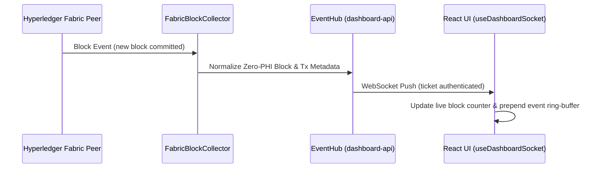

# Dashboard UI Design Specification

**Group 1 — Dashboard Module Implementation**  
Project: Blockchain-based Electronic Health Record (EHR) Platform  
Frontend Technology: React 18, Vite, Tailwind CSS, Lucide React, Recharts  

---

## 1. Design Overview & Styling System

The dashboard implements **CareOps**, an enterprise-grade healthcare observability console.  
- **Color Palette**: Clinical slate neutrals (`slate-50` to `slate-900`) with semantic accent highlights:
  - Doctor Agent: Primary Blue (`blue-600`)
  - Nurse Agent: Clinical Emerald (`emerald-600`)
  - Pharmacy Agent: Medicinal Violet (`violet-600`)
  - Lab Agent: Diagnostic Cyan (`cyan-600`)
- **Theme Support**: Seamless Light / Dark appearance with persistent cross-portal synchronization (`ehr_appearance`).
- **Responsive Layout**: Sticky application top-bar with live WebSocket stream pulse indicator, breadcrumb navigation, and responsive multi-column metric grid.

---

## 2. Reusable Component Hierarchy

```
dashboard-portal/src/
├── components/
│   ├── layout/
│   │   └── Layout.jsx          # Top navigation, stream live dot, role badge, theme switcher
│   ├── ClinicalAgentPage.jsx   # Shared template for Doctor, Nurse, Pharmacy, and Lab agent views
│   ├── AgentCard.jsx           # Summary card preview for agent registry listings
│   ├── AgentTrace.jsx          # Visual stepper showing execution lifecycle (Report → OCR → AI → IPFS → VCAP → Fabric)
│   ├── DataView.jsx            # Standardized paginated table with empty, loading, and error states
│   ├── MetricCard.jsx          # KPI display card with trend indicator and icon accent
│   ├── StatusBadge.jsx         # ONLINE / DEGRADED / OFFLINE pill indicator
│   ├── SeverityPill.jsx        # CRITICAL / WARNING / INFO security pill
│   ├── LoadingSkeleton.jsx     # Smooth CSS shimmer loading placeholder
│   └── ThemeToggle.jsx         # Light / Dark mode toggle switch
```

---

## 3. Specialized Clinical Agent Views (Sections 7–10 of Proposal)

### 3.1 Doctor Agent Dashboard (`/agents/doctor`)
- **Header**: Peer affiliation (`peer1.hospital.example.com`), Agent identity (`doctor-agent`), AI Model identifier and version.
- **KPI Metrics**:
  - `Active Visits`: 4-column responsive grid card
  - `AI Requests`: Real-time counter of physician-directed inferences
  - `Success Rate`: Formatted percentage with OK/Warning threshold color
  - `Avg Latency`: Second-decimal precision duration
- **Activity Feed**: Real-time reverse-chronological list of clinical consultations, lab views, and AI assistance requests.
- **Recent AI Executions**: Tabular view with Execution ID, Model, Latency, Status, and VCAP verification badge.
- **Trace Inspector**: Embedded multi-step execution pipeline visualization.

### 3.2 Nurse Agent Dashboard (`/agents/nurse`)
- **Header**: Peer affiliation (`peer2.hospital.example.com`), Agent identity (`nurse-agent`).
- **KPI Metrics**:
  - `Active Patients`: Current ward count
  - `Vitals Recorded`: On-chain vitals ledger commits
  - `AI Requests`: Nursing care plan advisory queries
  - `Avg Latency`: Vital entry commit latency
- **Nursing Activity Feed**: Vitals recordings, referral transitions, triage care updates.
- **Alerts Panel**: Highlighted warning panel for failed vital submissions or consent revocations.

### 3.3 Pharmacy Agent Dashboard (`/agents/pharmacy`)
- **Header**: Peer affiliation (`peer2.hospital.example.com` / pharmacy peer), Agent identity (`pharmacy-agent`).
- **KPI Metrics**:
  - `Prescriptions`: Incoming medical prescription orders
  - `Dispensed`: Confirmed medication releases
  - `Failed Txns`: Ledger lock or verification failures
  - `Avg Latency`: Dispensing verification response time
- **Pharmacy Activity Feed**: Dispensation history, verification passes, rejection reasons.
- **Inventory & Transaction Health**: Stock alerts and transaction consistency indicators.

### 3.4 Lab Agent Dashboard (`/agents/lab`)
- **Header**: Peer affiliation (`peer0.diagnostic.example.com`), Agent identity (`lab-agent`).
- **KPI Metrics**:
  - `Reports Today`: Total diagnostic records submitted
  - `AI Analyses`: Gemini / OCR automated triage inferences
  - `Success Rate`: Pipeline end-to-end success percentage
  - `Avg Latency`: Total pipeline transit duration
- **Pipeline Funnel**: Visual horizontal stage diagram:
  $$\text{Reports} \longrightarrow \text{Parse/OCR} \longrightarrow \text{AI Triage} \longrightarrow \text{IPFS} \longrightarrow \text{VCAP} \longrightarrow \text{Fabric}$$
- **Recent Executions**: Detailed report tracking table including IPFS CID and Fabric anchor verification.

---

## 4. Real-Time Streaming Architecture


- **Socket Authentication**: Stream ticket pattern (`POST /stream-ticket` $\to$ ephemeral single-use JWT bound ticket).
- **Auto-Recovery**: Automatic reconnection loop with jittered exponential backoff.
- **Ring Buffer**: In-memory rolling cache of the latest 100 events, preserving UI responsiveness without memory leaks.
