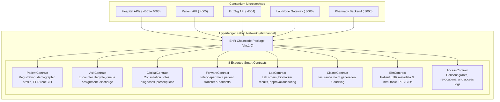

# Hospital EHR Chaincode — Smart Contract Package

This directory contains the production Hyperledger Fabric smart contract package for the Electronic Health Record (EHR) Consortium, deployed on the shared channel `ehrchannel`.

The package exports eight distinct smart contracts from `index.js`, implementing domain-separated access controls, clinical governance, and cross-organizational interoperability.

---

## 🏛️ Smart Contract Architecture



---

## 📜 Contract Reference & Responsibilities

| Contract | Source File | Key Transaction Functions |
|:---|:---|:---|
| **`PatientContract`** | `lib/patientContract.js` | `registerPatient`, `queryPatient`, `updatePatientDemographics`, `getPatientHistory` |
| **`VisitContract`** | `lib/visitContract.js` | `createVisit`, `finalizeVisit`, `dischargePatient`, `getVisitHistory` |
| **`ForwardContract`** | `lib/forwardContract.js` | `forwardToDoctor`, `forwardToNurse`, `forwardToLab`, `forwardToPharmacy` |
| **`ClinicalContract`** | `lib/clinicalContract.js` | `recordVitals`, `addDiagnosisNote`, `createPrescription`, `dispenseMedication` |
| **`LabContract`** | `lib/labContract.js` | `createLabRequest`, `acknowledgeLabRequest`, `recordDiagnosticReport`, `approveLabReport` |
| **`ClaimsContract`** | `lib/claimsContract.js` | `submitClaim`, `processClaim`, `auditClaimsHistory` |
| **`EhrContract`** | `lib/ehrContract.js` | `anchorEhrCid`, `getEhrHistory`, `verifyRecordMultihash` |
| **`AccessContract`** | `lib/accessContract.js` | `grantAccess`, `revokeAccess`, `checkAccess`, `getConsentAuditLog` |

---

## 🔒 Data Privacy & State Storage

- **World State (GoLevelDB / CouchDB):** Records are indexed by structured keys (e.g. `PATIENT_PAT-001`, `VISIT_VIS-2026-001`).
- **Zero-PHI Compliance:** Production deployments require patient identifiers to be pseudonymized and all bulky medical payloads (diagnostic scans, itemized invoices) pinned to IPFS, storing only the cryptographic CID multihash on-chain.
- **Multi-MSP Endorsement:** Transactions involving cross-organization workflows (such as Lab approvals and Pharmacy billing) enforce endorsement policies spanning `HospitalMSP`, `DiagnosticsMSP`, and `ProviderMSP`.

---

## 🚀 Deployment & Upgrades

Chaincode deployment is managed by the network bootstrap script:
```bash
cd orgs/hospital/EHR_hospitalOrg-main/ehr-network
bash scripts/deployChaincode.sh
```
This script packages the chaincode from `ehr-chaincode-v3/`, installs it on all 5 consortium peers across the 3 organizations, approves the definition, and commits it to `ehrchannel`.
