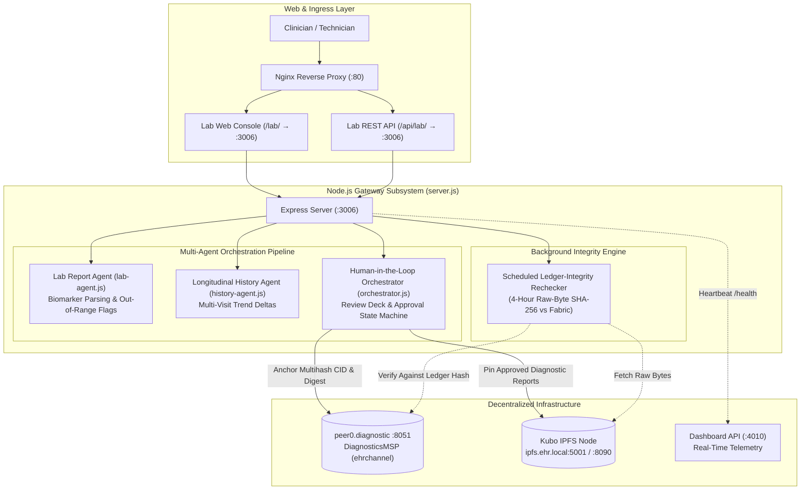

# Diagnostics Lab Gateway & Multi-Agent Subsystem

Autonomous Multi-Agent Diagnostic Pipeline, Human-in-the-Loop Clinical Review, IPFS Storage, and Scheduled Ledger Integrity Verification for the EHR Blockchain Consortium.

---

## 🎯 Architecture & Capabilities

The Lab Organization operates the `l-node-gateway` service (port `3006`), reverse-proxied at `http://localhost/lab/` and `http://localhost/api/lab/`. It is connected to the shared Hyperledger Fabric network on `ehrchannel` under **`DiagnosticsMSP`** and to the shared **Kubo IPFS node** (`ipfs.ehr.local:5001`).



---

## 🧩 Multi-Agent Subsystem Components

### 1. Lab Report Analysis Agent (`agents/lab-agent.js`)
- Parses unstructured laboratory text or structured JSON payloads.
- Extracts biomarkers: Hemoglobin, White Blood Cells (WBC), Platelets, Fasting Blood Glucose, Serum Creatinine, Total Bilirubin, and AST/ALT liver enzymes.
- Evaluates values against standard reference ranges and categorizes out-of-range flags (`CRITICAL_HIGH`, `HIGH`, `NORMAL`, `LOW`, `CRITICAL_LOW`).

### 2. Longitudinal History Agent (`agents/history-agent.js`)
- Queries historical records for a patient identifier across preceding visits.
- Calculates trend velocity (e.g. rising Creatinine over 3 months indicating renal deterioration).
- Generates clinical trajectory alerts feeding the clinician review deck.

### 3. Human-in-the-Loop Orchestrator (`orchestrator/orchestrator.js`)
- Manages diagnostic job lifecycle:
  `SUBMITTED` $\rightarrow$ `ANALYZED` $\rightarrow$ `PENDING_REVIEW` $\rightarrow$ `APPROVED` / `REJECTED` $\rightarrow$ `ANCHORED`.
- Strictly enforces human clinician review: reports **cannot** be anchored to the Fabric ledger without authenticated clinician sign-off.
- On approval: pins report to IPFS, receives CID, computes SHA-256 digest, and submits transaction to `ehrchannel` under `DiagnosticsMSP`.

### 4. Scheduled Ledger-Integrity Recheck Engine (`integrity-check.js`)
- Runs as an automated background daemon every 4 hours.
- Traverses all anchored diagnostic records on the ledger.
- Streams raw payload bytes directly from IPFS (`http://ipfs.ehr.local:5001/api/v0/cat?arg=<CID>`).
- Computes `SHA256(RawBytes)` in memory and confirms exact equality with the cryptographic digest recorded on Fabric.
- Emits real-time verification status via `GET /api/integrity/status` and manual recheck trigger via `POST /api/integrity/run`.

---

## 📡 REST API Reference

All routes are mounted at `/api/lab` through Nginx or directly at `http://localhost:3006`:

| Method | Endpoint | Description |
|:---|:---|:---|
| `GET` | `/api/health` | Health check & system diagnostics (Monitored by Dashboard as `lab-gateway`) |
| `GET` | `/api/meta` | Runtime metadata, channel info, and IPFS status |
| `GET` | `/api/records` | List all anchored laboratory diagnostic records |
| `GET` | `/api/records/:resultId` | Retrieve single diagnostic record by ID |
| `POST` | `/api/records` | Submit new diagnostic record |
| `POST` | `/api/orchestrator/jobs` | Submit diagnostic payload to the Multi-Agent pipeline |
| `GET` | `/api/orchestrator/jobs/:jobId` | Retrieve pipeline status and agent analysis outputs |
| `POST` | `/api/orchestrator/jobs/:jobId/approve` | Clinician sign-off: approves job, pins to IPFS, and anchors to Fabric |
| `POST` | `/api/orchestrator/jobs/:jobId/reject` | Clinician rejects diagnostic report with review notes |
| `GET` | `/api/history-agent/patients/:id` | Fetch longitudinal historical trend trajectory for a patient |
| `GET` | `/api/integrity/status` | Current ledger integrity status and last recheck timestamp |
| `POST` | `/api/integrity/run` | Trigger immediate on-demand ledger integrity recheck |

---

## 🎨 Web Console Interface

Access the console at [http://localhost/lab/](http://localhost/lab/):
- **Obsidian Dark Mode:** Consistent with the Vitalis and CareGrid design systems.
- **Radiant Gradient Cards:** Cards feature subtle glowing gradients spreading from opposite corners (`rgba(56, 189, 248, 0.12)` to `rgba(168, 85, 247, 0.12)`).
- **Human-in-the-Loop Review Deck:** Real-time table of pending reports with out-of-range biomarker highlights, historical trajectory deltas, and 1-click Approve / Reject controls.
- **Ledger Integrity Status Badge:** Live indicator displaying total verified records, pass/fail state, and last verification timestamp.

---

## 🧪 Automated Test Suite

Run the full Jest test suite:
```bash
cd orgs/lab/EHR-LABORG-main/client/node-gateway
npm test
```
**Results:** **24 unit tests passing** across 3 test suites:
- `agents/lab-agent.test.js`: 10 passed
- `agents/history-agent.test.js`: 8 passed
- `integrity-check.test.js`: 6 passed
