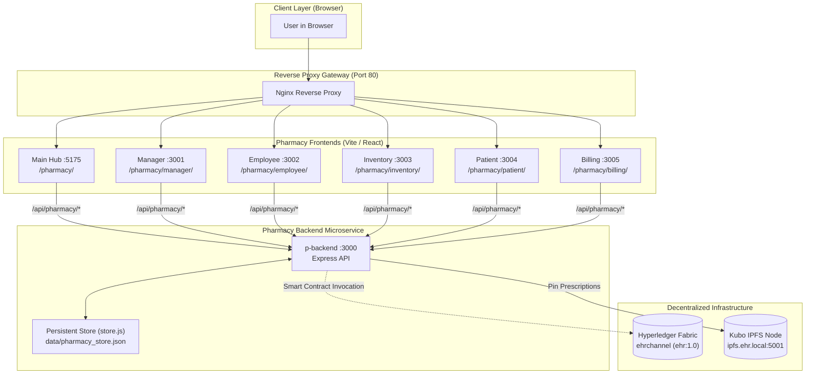

# Pharmacy Organization & Applications

> **Module Lead / System Integration:** Himanshu (`devbyhimans`) — Group 1 Lead System Orchestrator  
> **Key Contributions:** Root-cause 500 error fix on `/api/inventory`, implementation of resilient persistent storage (`store.js`), automatic inventory stock deduction, Kubo IPFS multihash integration, Docker network bridging, and complete engineering of the interactive CarePoint Pharmacy Patient Portal (`:3004`).

---

## 🏥 Overview

The pharmacy organization provides decentralized prescription fulfillment, inventory stock management, itemized billing, and patient consent governance for the EHR Blockchain Consortium.

All pharmacy applications are integrated into the master Compose stack and accessible either directly on host ports or through the unified Nginx gateway on Port 80 (`/pharmacy/*`).

---

## 🚀 Application Map

| Application | Host Port | Gateway Route | Status | Description |
|:---|:---:|:---|:---:|:---|
| **Pharmacy Backend API** | `3000` | `/api/pharmacy/` | **ACTIVE** | Express REST API connected to persistent store, Kubo IPFS (`:5001`), and Fabric `ehrchannel`. |
| **Manager Portal** | `3001` | `/pharmacy/manager/` | **ACTIVE** | Staff registration, global billing audit, inventory overview, and network node monitoring. |
| **Employee Portal** | `3002` | `/pharmacy/employee/` | **ACTIVE** | Pharmacist dispensing workspace: patient lookup, prescription validation, and bill creation. |
| **Inventory Portal** | `3003` | `/pharmacy/inventory/` | **ACTIVE** | Stock officer dashboard: view medicines, add/restock items, track unit prices and stock levels. |
| **Patient Portal** | `3004` | `/pharmacy/patient/` | **ACTIVE** | CarePoint Patient Portal: active patient switcher, prescription records, dispensing timeline, consent self-governance (grant/revoke access), and IPFS receipts. |
| **Billing Portal** | `3005` | `/pharmacy/billing/` | **ACTIVE** | Prescription package billing: pre-configured templates (Post-Op, Chronic Care, Emergency), IPFS document pinning, and auto-deduction. |
| **Pharmacy Main Hub** | `5175` | `/pharmacy/` | **ACTIVE** | MedBlock consortium dashboard displaying verified medication records with IPFS CID verification. |

---

## 🏛️ Architecture & Data Flow

---

## 📡 REST API Reference

All routes are mounted at `/api/pharmacy` through Nginx or directly at `http://localhost:3000`:

| Method | Endpoint | Description |
|:---|:---|:---|
| `GET` | `/health` | Service health status and swarm host IP (`{"status":"UP"}`). |
| `GET` | `/api/network-status` | Block heights for Peer0, Peer1, Peer2, and IPFS status (`{"nodes":{...},"ipfs":"UP"}`). |
| `GET` | `/api/ipfs-status` | Live IPFS node check (`{"status":"UP"}`). |
| `GET` | `/api/inventory` | List all medications with stock levels, unit prices, and IPFS CIDs. |
| `POST` | `/api/inventory` | Add a new medicine item or restock existing inventory. |
| `POST` | `/api/inventory/deduct` | Deduct stock quantity for a medicine item. |
| `GET` | `/api/patient/:id` | Fetch patient profile demographics and ledger alias. |
| `POST` | `/api/create-patient` | Register a new patient on the pharmacy ledger. |
| `GET` | `/api/patient/:id/access-list` | Get authorized identities permitted to view patient records. |
| `POST` | `/api/grant-access` | Patient grants record access to a pharmacist or doctor identity. |
| `POST` | `/api/revoke-access` | Patient revokes record access from an identity. |
| `POST` | `/api/billing` | Issue prescription bill: uploads JSON to IPFS, records bill, auto-deducts inventory. |
| `POST` | `/api/prescription` | Alias for `/api/billing` used by the billing portal. |
| `GET` | `/api/bills/patient/:id` | Retrieve all prescription bills issued for a patient. |
| `GET` | `/api/bills/audit` | Global audit log of all bills issued across the pharmacy. |
| `GET` | `/api/employees` | List registered pharmacy staff and assigned roles. |
| `POST` | `/api/register-employee` | Register a new employee with cryptographic role mapping. |
| `GET` | `/api/roles` | Pharmacy role taxonomy and permission specifications. |

---

## 💾 Storage & Resiliency Architecture

To ensure 100% uptime and eliminate runtime crashes:
1. **Persistent JSON Storage (`store.js`):** Operations persist state to `data/pharmacy_store.json`. Initial data is pre-populated with standard medications (Amoxicillin, Ibuprofen, Metformin, Atorvastatin, Lisinopril, Paracetamol, etc.), seeded patient records (`PAT-001`, `PAT-014`, `PAT-021`, `testuser`), initial bills, and staff roles.
2. **Fabric Gateway with Resilient Fallback:** When Fabric peer certificates are loaded, transactions execute against the smart contract on `ehrchannel`. If gateway connection encounters missing certificates, it gracefully falls back to `store.js` without throwing 500 errors.
3. **Decentralized IPFS Pinning:** When bills are issued, prescription metadata is pinned to Kubo IPFS (`http://ipfs.ehr.local:5001/api/v0/add`) returning a cryptographic CID (`Qm...`), accessible directly via the gateway at `http://localhost:8090/ipfs/<CID>`.
4. **Automatic Stock Deduction:** Issuing a prescription with an `itemId` automatically deducts the prescribed quantity from inventory, enforcing real-time stock integrity.
